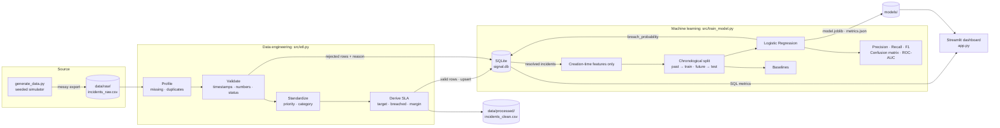

# SIGNAL — AI Incident Intelligence Lab

A small, local, end-to-end project where **data engineering** and **machine learning** work together on a single operational question:

> *When an IT incident is opened, how likely is it to breach its SLA, and what should the team look at first?*

It generates realistic synthetic IT incidents, cleans them with a repeatable ETL pipeline, stores them in SQLite, trains a leakage-safe Logistic Regression to estimate breach risk, and shows everything in a Streamlit dashboard.

**Stack:** Python 3.11+ · Pandas · SQLite · scikit-learn · Streamlit · Plotly. No cloud and no paid APIs.

---

## Quick start

```bash
python -m venv .venv && source .venv/bin/activate   # Windows: .venv\Scripts\activate
pip install -r requirements.txt

python -m src.generate_data     # 1. create data/raw/incidents_raw.csv (510 messy rows)
python -m src.etl               # 2. clean + validate + load into data/processed/signal.db
python -m src.train_model       # 3. train, evaluate, save models/, score every incident
python -m pytest                # 4. run the 24 tests
streamlit run app.py            # 5. open http://localhost:8501
```

You can rerun step 2 any number of times. Incidents are upserted by `incident_id`, so nothing is duplicated, and the dashboard's run history shows `new_incidents = 0` on a rerun.

---

## Architecture



**Database tables:** `incidents` (clean facts) · `predictions` (model scores) · `pipeline_runs` (one row per ETL run) · `rejected_records` (every bad row with its reason and the original row as JSON).

---

## Components: what each does, why it exists, what it depends on

| File | What it does | Why it exists | Depends on |
|---|---|---|---|
| `src/config.py` | Paths, SLA policy, valid values, risk bands | One source of truth, so every component agrees on what "Critical = 240 min" means | nothing |
| `src/generate_data.py` | Simulates 500 incidents and then makes the export messy | We need realistic data with known problems to prove the pipeline works | numpy, pandas, config |
| `src/etl.py` | Extract → profile → dedupe → validate → standardize → derive SLA → load | Raw data is never trusted. This is the gate between "export" and "fact" | pandas, database, config |
| `src/database.py` | Schema, upserts, run logging, and **all SQL metric queries** | Keeps the SQL in one place. The dashboard only reads | sqlite3 (built in), pandas |
| `src/train_model.py` | Feature engineering, leakage guard, chronological split, training, evaluation, explanations, scoring | Turns history into a forward-looking risk estimate | scikit-learn, joblib, database |
| `app.py` | Four-tab dashboard: Overview, Explorer, AI Predictions, Data Quality | Where people make decisions with the data | streamlit, plotly, database, train_model |
| `tests/` | 24 pytest tests | Proves cleaning, deduplication, SLA math, DB writes and model input checks actually work | pytest |

---

## Data generation rules

Seed `42`. Re-running the generator always produces the same file.

**Incidents (500, Jan to Jun 2024)**
- **Creation time:** a random day, with about 60% of weekend tickets pushed to Monday or Tuesday. 75% fall in business hours (08:00–17:59) and the rest overnight or in the evening.
- **Priority mix:** Critical 5% · High 15% · Medium 45% · Low 35%.
- **SLA resolution targets:** Critical 240 min · High 480 · Medium 1,440 · Low 4,320.
- **Category mix:** Software 28% · Access 18% · Hardware 16% · Network 16% · Email 12% · Database 10%. Each category has its own services (for example, Database → Data Warehouse / ERP / CRM).
- **Assignment group:** the category's specialist team, except that 15% of non-Email tickets are left with the **Service Desk** (misrouted).
- **Response time:** log-normal around a priority median (10 / 25 / 90 / 300 min).
- **Resolution time:** `SLA target × priority ratio × risk factors × log-normal noise`. These are the hidden drivers, and all of them are known at creation:

  | Driver | Multiplier |
  |---|---|
  | Category: Database / Network / Software / Hardware / Email / Access | 1.35 / 1.15 / 1.10 / 1.00 / 0.85 / 0.80 |
  | Service: ERP, Data Center / Data Warehouse | 1.20 / 1.15 |
  | Misrouted to Service Desk | 1.30 |
  | Created off-hours (before 08:00 or from 18:00) | 1.35 |
  | Created on a weekend | 1.40 |

- **Status:** the 25 most recent tickets are `Open` or `In Progress`, with no resolution time and an unknown outcome. The rest are `Closed` (70%) or `Resolved` (30%).
- **Outcome:** `sla_breached = resolution > target`. The result is about a 21% breach rate.

**Injected data-quality problems** (so the ETL has real work to do)

| Problem | Rows | ETL action |
|---|---|---|
| Exact duplicate rows | 10 | removed (keep first) |
| Missing priority | 5 | rejected |
| Missing category | 3 | rejected |
| Invalid timestamp (`2024-13-45`, `not a date`, …) | 4 | rejected |
| Negative response time | 4 | rejected |
| Non-numeric response time (`N/A`) | 3 | rejected |
| Resolution shorter than response | 3 | rejected |
| Priority spelling variants (`P1`, `critical`, `med`, …) | ~40 | standardized |
| Category variants (`H/W`, `DB`, `E-mail`, …) | ~40 | standardized |
| Padded whitespace in team names | 15 | trimmed |

Result: **510 rows read → 478 loaded, 32 rejected** (10 duplicates + 22 invalid). The raw file stays untouched in `data/raw/`. The cleaned copy is in `data/processed/incidents_clean.csv`.

---

## ETL design decisions

- **Read everything as text.** Pandas would otherwise silently turn `"N/A"` into NaN or guess date formats. We parse explicitly and log what fails.
- **Every rule has a reason string.** A row that fails three rules lists all three, joined by `; `.
- **SLA targets come from policy, not the file.** `sla_target_minutes` is recomputed from priority, and `sla_breached` is recomputed from times. A clean pipeline doesn't trust a derived field from the source.
- **Open incidents are valid.** Their blank resolution time is expected and their outcome is `NULL` (unknown), never "met".
- **Idempotent load.** `INSERT … ON CONFLICT(incident_id) DO UPDATE` means a rerun updates rows in place. A ticket that was open last run and is closed now gets updated, not duplicated.
- **One transaction per load.** Incidents, rejected records and the run summary are committed together or not at all.

---

## Machine learning design

**Target:** `sla_breached` (1/0), on resolved incidents only.

**Inputs (creation-time only):** priority, category, affected service, assignment group, `shift` (business hours / evening / overnight from the creation hour), and `is_weekend`.

**Excluded to prevent leakage:** resolution time, response time, status, SLA margin and the outcome. All of these happen *after* the ticket is opened. `build_features()` selects only the allowed columns and asserts that no leakage column got through, and a test enforces this.

**Split:** chronological. The oldest 80% is used for training (Jan 1 → May 18) and the newest 20% for testing (May 20 → Jun 20). A random split would let the model "see the future".

**Model:** one-hot encoding → `LogisticRegression(class_weight="balanced")`. Balancing stops the model from ignoring the ~20% minority class. The trade-off is that scores lean high, so the dashboard presents them as **relative risk estimates**.

**Results on the hold-out test set** (91 incidents, 19% breached):

| Model | Precision | Recall | F1 | ROC-AUC |
|---|---|---|---|---|
| **Logistic Regression** | 0.370 | **0.588** | **0.455** | **0.774** |
| Baseline: flag priorities that breach above average | **0.429** | 0.353 | 0.387 | 0.612 |
| Baseline: always predict "no breach" | 0.000 | 0.000 | 0.000 | 0.500 |

How to read this:
- The model **ranks risk much better** (AUC 0.77 vs 0.61) and **catches more breaches** (59% vs 35%).
- The priority rule is **slightly more precise**: when it raises an alarm it is right more often, but it misses most breaches.
- The "always no" model scores 81% *accuracy* and catches **zero** breaches. That is why accuracy isn't reported.
- 91 test rows is a small sample, so these numbers would move by several points with different data.

**Coefficients, and why they are not causes.** The dashboard plots each feature's weight. Positive weights push the estimate up. The generator gave Hardware a neutral 1.0× factor, yet the model assigns `category = Hardware` a *positive* weight. That happens because Hardware tickets are compared against a mix of baseline categories, share credit with their team (Desktop Support, which gets a large negative weight), and the sample is small. Coefficients describe patterns in this history. They do not tell you what to change.

---

## Dashboard

| Tab | What you get |
|---|---|
| **Overview** | KPI cards (total, SLA compliance, average resolution, high priority) and compliance by priority, category, month and team. All of it comes from SQL. |
| **Incident Explorer** | Search, priority and category filters, a sortable table with estimated risk bars, and an incident detail panel |
| **AI Predictions** | Open incidents ranked by risk, a what-if scorer with a per-incident explanation, model vs. baseline metrics, the confusion matrix, the ROC curve and the coefficients |
| **Data Quality** | Rows read, loaded and rejected, missing values in the raw file, validation failures, rejected records with the original row, and run history |

Design: charcoal `#1A1A1D`, accent `#FF4F00`, rounded KPI cards, Inter font, thin bars, recessive grid. Risk bands are always written out (Low / Medium / High), so the meaning never relies on color alone.

---

## Project layout

```
├── app.py                    Streamlit dashboard
├── requirements.txt
├── pytest.ini
├── .streamlit/config.toml    dark theme
├── src/
│   ├── config.py             paths + business rules
│   ├── generate_data.py      synthetic incident simulator
│   ├── etl.py                validation + cleaning pipeline
│   ├── database.py           SQLite schema, writes, SQL metrics
│   └── train_model.py        features, training, evaluation, scoring
├── data/
│   ├── raw/                  incidents_raw.csv (committed, reproducible)
│   └── processed/            signal.db, clean + rejected CSVs (generated)
├── models/                   sla_model.joblib, metrics.json (generated)
└── tests/                    test_etl.py · test_database.py · test_model.py
```

## Limitations (stated plainly)

- The data is synthetic. The patterns exist because the generator put them there, so this demonstrates the method, not real-world findings.
- About 450 labelled rows is small. The metrics have wide uncertainty.
- Probabilities are not calibrated (because of balanced class weights). Use them to rank and triage, not as exact odds.
- SQLite is single-user and local. That is fine here; see the Microsoft Fabric / Azure path below to scale it.

## Path to Microsoft Fabric / Azure ML / Foundry

| Today (local) | Scaled equivalent |
|---|---|
| CSV in `data/raw/` | Fabric **Lakehouse** bronze layer, fed by a Data Factory pipeline from ServiceNow or Jira |
| `etl.py` (pandas) | Fabric **Notebook** or Dataflow Gen2 writing silver/gold **Delta tables**. The validation rules port as-is |
| SQLite + SQL metrics | Fabric **Warehouse** / SQL endpoint, with the same SQL |
| `train_model.py` | **Azure ML** job with MLflow tracking, model registry and a scheduled retrain |
| `predictions` table | Azure ML **managed endpoint** that scores each ticket the moment it is created |
| Streamlit | **Power BI** on Direct Lake for operations, with Streamlit kept for ML exploration |
| Coefficient explanations | **Azure AI Foundry** agent that writes plain-language triage notes grounded in the score and features |
