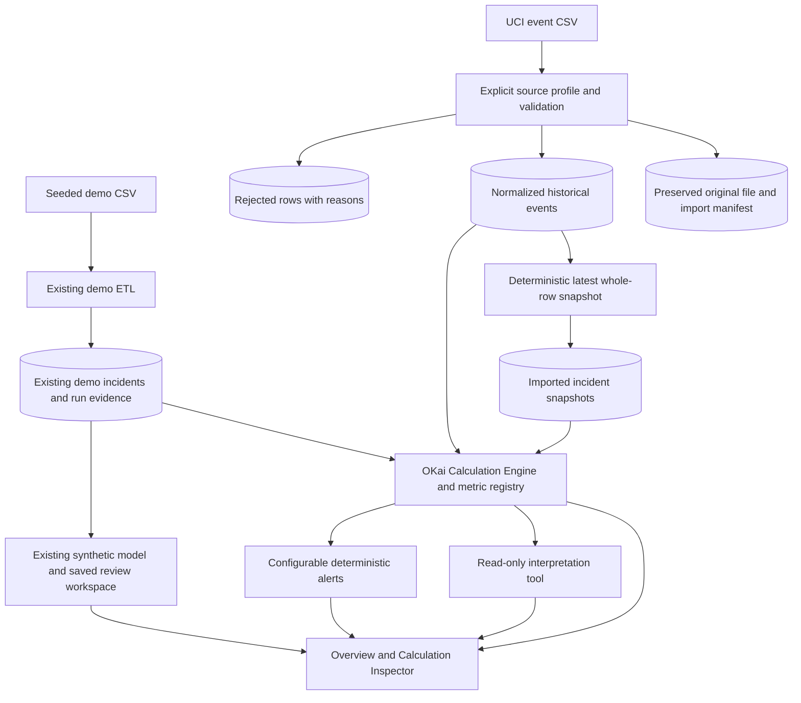

# OKai architecture and implementation inventory

OKai is a local **Operational Decision Intelligence** portfolio application. Its purpose is to turn incident records into validated measures, explainable risks, and evidence a person can inspect before acting. **Make every metric meaningful.**

This inventory records the starting implementation inspected on 2026-11-21, before the calculation-engine and event-import changes. Proposed capabilities below must not be read as features that existed at that checkpoint. The implementation notes and [validation record](VALIDATION.md) identify what was subsequently delivered.

## Phase 0: observed implementation

| Area | Existing, verified capability | Gap or risk | Reusable part / proposed change |
|---|---|---|---|
| Launch | [PowerShell launcher](../run.ps1) prepares a local Python runtime, installs requirements, prepares missing demo artifacts, and launches Streamlit; the VS Code task invokes it | First setup needs internet; requirements use minimum versions rather than a locked environment | Keep the launcher and existing task; add no framework or service |
| Sources | [Seeded generator](../src/generate_data.py) produces a repeatable 510-row synthetic incident snapshot | Exact 11-field contract cannot ingest the UCI event schema | Retain the synthetic profile; introduce an explicit UCI mapping profile |
| ETL | [Validation pipeline](../src/etl.py) parses types, normalizes demo labels, rejects invalid rows with reasons, and loads transactionally | Keep-first ID deduplication is suitable only for the demo snapshot contract; `?` is not recognized as unknown; fixed demo priority/category vocabularies differ from source codes | Keep the legacy demo pipeline isolated; add event-aware ingestion rather than renaming source columns blindly |
| Storage | [SQLite layer](../src/database.py) has incident facts, current predictions, ETL-run summaries, and rejected-row evidence | No raw-file hash/import identity, event table, or historical source namespace; latest upserts lack a source-freshness comparison | Add separate import/event/snapshot tables without replacing demo facts |
| Metrics | Parameterized SQL supplies overview and grouped SLA metrics; known outcomes form the SLA denominator | Definitions, exclusions, and rounding are not available as structured metric results; some business arithmetic lives near views | Introduce a shared metric registry and calculation result contract, consumed by the UI |
| Statistical model | [scikit-learn pipeline](../src/train_model.py) uses a creation-time feature allowlist, chronological synthetic hold-out, baselines, and coefficient contributions | No validation on UCI history; a creation-time split does not simulate historical label availability; scores are uncalibrated | Preserve the demo model and its artifacts; do not score imported event snapshots with it |
| Saved reviews | [Demo workspace layer](../src/demo.py) persists team, owner, review state, handover notes, and audit events separately from facts | Persona selector and UUID URL are not authentication or tenant security | Preserve the walkthrough; retain explicit simulation wording |
| Data quality | [Quality report](../src/quality.py) reconciles loaded/duplicate/invalid rows and distinguishes rule matches from missing cells | This report assumes the existing saved-run contract; event intake needs its own grain and missing-value semantics | Reuse chart principles, not incompatible source assumptions |
| Interface | [App](../app.py), [views](../src/views.py), [UI helpers](../src/ui.py), and [chart system](../src/charts.py) provide navigation, exports, risk lab, and quality panels | No import desk or calculation inspector at baseline; unqualified compliance labels need source context | Add views that consume backend results rather than repeating formulas |
| Branding | OKai title/task/launcher and the [reflected italic wordmark](../assets/okai-wordmark.svg) are present | README category still says AI Incident Intelligence Lab; old signal-oriented hero language remains | Adopt Operational Decision Intelligence and the [brand language](BRAND.md); preserve compatibility identifiers |
| Tests | Baseline run: **46 pytest tests passed** for demo ETL, SQL, features, workspace isolation, quality, and reset | No event-import, registry, explanation-contract, timezone, or real-file integration tests | Extend the existing pytest suite with focused known-example and independent-reference checks |

Dependencies already in [requirements](../requirements.txt): pandas, numpy, scikit-learn, Streamlit, Plotly, joblib, pytest. SQLite and hashing/date/path utilities are in Python's standard library. No new dependency was required by this architecture. An external AI provider, identity provider, API connector, or MCP client is not configured.

### Baseline database relationships

- `incidents.incident_id` is the demo fact key; `predictions.incident_id` references it and stores only the current score.
- `pipeline_runs.run_id` identifies an ETL attempt; `rejected_records.run_id` references it and retains the original row as JSON.
- `demo_workspaces.workspace_id` identifies saved review state; `demo_reviews` has a composite workspace/incident key and references the incident fact.
- `demo_events` references that composite review key and records a review change plus note. Workspace reset deliberately clears this simulated review state.

These relationships are the starting schema, not evidence that source-event history existed. New import tables remain separate so a real-file test cannot silently replace the original demo.

## Six connected layers

| Layer | Responsibility and contract | Deliberate boundary |
|---|---|---|
| 1. Source integration | Local CSV inputs with a named, versioned mapping profile and explicit source contract | Future ITSM/API integrations require a real schema and authorization; no speculative connector |
| 2. Data foundation | Preserve original bytes; record hash, mapping/timezone assumptions, validation evidence, normalized events, deterministic latest whole-row incident snapshots | An event is not an incident; unknown values stay unknown; arbitrary first-row deduplication is not a history model |
| 3. Calculation intelligence | One registry defines grain, fields, formula, eligible population, exclusions, units, rounding, and version; structured results carry lineage and warnings | No UI-specific copies of business arithmetic; zero denominator returns unavailable |
| 4. Decision intelligence | Configurable deterministic thresholds consume validated data; alerts state their evidence, missing inputs, and limitations | Demonstration thresholds are not contractual SLA policy; separate rule alerts from model estimates |
| 5. AI interpretation | A strict read-only internal tool retrieves authorized calculation results and creates grounded explanations | No external generative AI is configured; explanations cannot invent costs, deadlines, causes, or metric values |
| 6. User experience | Overview, import workflow, calculation inspection, quality, historical exploration, and existing demo review/risk walkthrough | Source selection and scope must remain visible; persona login remains simulated |

## Integrity rules

1. Preserve the raw source independently from normalized records. A content hash identifies the bytes, while a mapping/version/timezone configuration identifies their interpretation.
2. Preserve every valid event. Select the latest complete source row with documented timestamp, revision counter, and source-row tie-breakers. Do not combine nonnull values from unrelated rows into an invented snapshot.
3. Keep unknown assignment as an explicit reporting category. Do not impute a response time from record creation timestamps.
4. Derive gross elapsed resolution duration only from valid opened/resolved timestamps with nonnegative intervals. This is not business-calendar SLA duration.
5. Label UCI `made_sla` as **source-reported SLA attainment**. Preserve the source outcome; do not overwrite it using the demo policy.
6. Keep retrospective outcomes out of predictive inputs. Earlier event rows can already contain later resolution/closure enrichment.
7. Expose eligibility, exclusions, formula version, observation window, source/import ID, assumptions, and calculation time with each result.
8. Permit no destructive migration or external deployment as part of local implementation. Existing `signal.db`, model paths, logger names, and historical records remain compatibility identifiers.

## Implemented backend contracts

The baseline gaps above are historical inventory. The following additive modules implement the new backend design; final regression/UI evidence is recorded in [validation](VALIDATION.md).

| Module / contract | Implemented responsibility |
|---|---|
| [Event ingestion](../src/event_ingestion.py): `MappingProfile`, `UCI_PROFILE`, `import_event_log` | Validate the explicit source schema, preserve exact bytes and hash, normalize types and missing sentinels, retain event history, and create deterministic latest whole-event pointers. |
| Event reads: `list_imports`, `read_import`, `read_events`, `read_snapshots`, `read_initial_snapshots`, `read_rejections`, `event_count` | Select an import cohort, inspect provenance and rejections, and retrieve only needed event columns. Initial snapshots mean earliest observed, not verified creation-time inputs. |
| [Calculation engine](../src/calculations.py): `CalculationContext`, `CalculationEngine`, registry | Accept unique incident snapshots and separate events; expose 16 registered operational/scenario metrics, structured results, record eligibility evidence, grouped/monthly reporting, and deterministic rules. |
| Engine methods: `calculate`, `inspect`, `summary`, `by_dimension`, `monthly_trend`, `alerts` | Produce authoritative results and evidence for views without depending on Streamlit or selecting files/databases. |
| [Read-only interpretation](../src/calculation_tools.py): `execute_metric_tool` | Validate `list_metrics`, `calculate`, `inspect`, and `alerts` requests against strict field/action/parameter allowlists and bounded record pagination. |
| [Investigations](../src/investigations.py): `build_trace_reference`, `create_investigation`, `record_outcome`, `build_review_export` | Attach an owner, rationale, next action, and follow-up date to one incident's compact, content-addressed calculation trace; append immutable/append-only outcome history; export the full saved review (decision fields, reported outcome, trace, audit history) as one reconciled JSON file. |

The event adapter stores `source_imports`, `source_events`, `source_incidents`, and `source_rejections` in **`data/processed/okai_imports.db`**, separate from the existing demo database. `source_incidents` points to an entire event using `(import_id, source_row)`, preventing a mixture of columns from different observations. Raw bytes and audit exports live in ignored `data/imports/`; the complete mapping-profile fingerprint and file SHA jointly define idempotency. Imports remain separate cohorts rather than an unverified cross-file merge.

The isolated import database also records `source_import_attempts`. An attempt moves through
`preserving`, `parsing`, `validating`, `normalizing`, `exporting`, `database_write`, and
`committed`; failures remain `failed`, and stale active attempts are marked `interrupted`
by a later retry. Fact tables, snapshot pointers, and rejections commit in one SQLite
transaction, so a failed database write rolls back the complete cohort. Retrying a failed
source/profile reuse the existing import identity and generated audit directory while the
committed source namespace remains unchanged.

An unknown source timezone stays explicit and source-local. A confirmed named zone is strictly localized and normalized to UTC; invalid/DST-ambiguous core event times are rejected, while invalid optional values become unknown with retained warnings. Financial and efficiency metrics require explicit matched-scope scenario inputs. A read-only tool is a future AI integration seam, not a claim that an AI service is connected or that the interface itself performs user authorization.

## Guided demo and session state

`app.py` selects the mock persona and analysis source and dispatches pages.
`src/tutorial.py` stores mission order, checkpoints and navigation in
Streamlit session state; it does not persist tutorial progress. The guide
uses only synthetic data. Changing to an import pauses the guide, and an
explicit resume or restart returns to the synthetic source. Completed and
skipped checkpoints are distinguished; successful saves and calculations,
not merely button clicks, unlock their corresponding missions.

Each journey begins with orientation and confirms that the incident queue was
opened before allowing the user to continue. Role-specific mission orders then
link handover, source quality, metrics, evidence, risk, investigation and
assumption-based scenarios. UI callbacks record an inspection request, but the
overview and evidence checkpoints are verified only after the relevant
calculation and evidence load successfully. The guide provides recovery
instructions, back/skip/restart/exit controls, and a final verified/skipped
summary; it never treats a skipped step as verified. Focus outlines use
Streamlit keyed containers with an explicit text/button fallback, so guidance
does not depend on visual highlighting alone.

Review assignments and audit events remain workspace-scoped demo overlays
in the demo database, separate from incident facts and imported records.
Mock names and positions are display labels, not new persisted identifiers.
Metrics and their evidence continue to come from the calculation engine.
Risk estimates use the synthetic model only; missing scores remain unavailable,
and scenario costs and time savings depend on user-supplied assumptions.

`src/investigations.py` adds separate `investigations`, `investigation_events`,
and `calculation_traces` tables to the application SQLite database. Synthetic
records use the stable `synthetic-demo` source ID; imported records use their
immutable import ID. A case references a content-addressed, schema-versioned
trace containing only the selected incident's calculation rows, or its
source-count membership when the metric is source-wide, not a duplicate full
evidence export. Trace rows cannot be updated or deleted; follow-up outcomes
append to the case event history. The source incident and import tables remain
unchanged.

## Deployment and next boundaries

One Python application and a local SQLite database are appropriate for this portfolio scope. Streamlit calls ordinary backend functions; the calculation engine is not a separate microservice. SQLite supports multiple readers and serialized writes, but no workload/concurrency guarantee has been established here.

Moving into a real organization requires a source/SLA contract, access controls, retention policy, backup/restore evidence, representative workload tests, and operational ownership. These are future requirements, not implemented enterprise certification. A future API or MCP surface should reuse the same validated internal contracts only when a real client needs it.

See the [metric reference](METRICS.md), [historical-event case study](CASE_STUDY.md), [brand decisions](BRAND.md), and [validation record](VALIDATION.md) for evidence and remaining boundaries.
