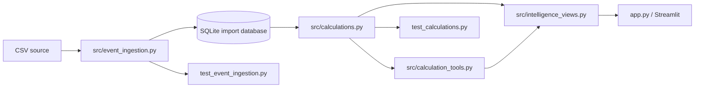

# OKai visual code study guide

Open the `Jetinfo` folder itself in VS Code. The enclosing `signal-project`
folder is a separate wrapper repository. This guide is the shortest path from
the product screen to the code, data, tests, and evidence behind it.

## 1. Start the visual workspace

1. Open `Jetinfo` in VS Code.
2. Accept the recommended extensions:
   - **Python** and **Pylance** for navigation, types, test discovery, and
     inline diagnostics.
   - **Git Graph** for chronological branch and commit study.
   - **SQLite Viewer** for opening `data/processed/*.db` without writing SQL.
   - **Markdown Mermaid** and **Markdown All in One** for architecture diagrams
     and linked documentation.
3. Run **Terminal > Run Task > OKai: Run dashboard**.
4. Open `http://localhost:8501`.

The local launcher prepares `.venv`, `.tools`, demo data, and model artifacts.
No MCP server, cloud service, paid API, or external AI service is required for
this repository. The calculation tool is an internal Python read-only seam,
not a deployed MCP server.

## 2. Read the system as a vertical slice

Follow one metric from its source to the screen:



Study in this order:

| Order | File | Question to answer |
|---|---|---|
| 1 | `src/config.py` | Where are paths, policies, and thresholds defined? |
| 2 | `src/generate_data.py` | How is deterministic demo data made intentionally messy? |
| 3 | `src/etl.py` | How are parsing, validation, rejection, and upsert separated? |
| 4 | `src/database.py` | How do parameterized SQL and transactions protect facts? |
| 5 | `src/event_ingestion.py` | How are raw bytes, event history, profiles, and snapshots preserved? |
| 6 | `src/calculations.py` | What is the authoritative metric contract and eligibility rule? |
| 7 | `src/calculation_tools.py` | Which read-only operations are allowed and rejected? |
| 8 | `src/intelligence_views.py` | How does the UI consume evidence rather than recreate formulas? |
| 9 | `src/views.py` and `app.py` | How are navigation, state, forms, and source selection connected? |

Use **Go to Definition**, **Find All References**, and the call hierarchy from
Pylance while following `CalculationEngine.calculate()` into the views and
tests. Keep `docs/METRICS.md` open beside the implementation; it is the
human-readable version of the metric contract.

## 3. Inspect the data visually

Run **OKai: Rebuild data and model**, then use SQLite Viewer:

| Database | What to inspect |
|---|---|
| `data/processed/signal.db` | Demo incidents, predictions, ETL runs, rejected records, and review state |
| `data/processed/okai_imports.db` | Imported cohorts, source events, snapshots, rejections, and import attempts |

Compare these grains deliberately:

- one row in `incidents` or `source_incidents` represents an incident snapshot;
- many rows in `source_events` may belong to one incident;
- `source_rejections` is evidence about input quality, not an incident fact;
- `demo_reviews` and `demo_events` are simulated workspace state, not source data.

## 4. Use the dashboard as a code map

| Dashboard area | Start reading here | Then inspect |
|---|---|---|
| Overview | `src/intelligence_views.py` | `src/calculations.py`, `docs/METRICS.md` |
| Import Desk | `src/views.py` | `src/event_ingestion.py` |
| Calculation Inspector | `src/intelligence_views.py` | `CalculationEngine.inspect()` and evidence tests |
| Data quality | `src/quality.py` | `src/etl.py`, `src/event_ingestion.py` |
| Risk lab | `src/views.py` | `src/train_model.py` |
| Project notes | `src/views.py` | `docs/ARCHITECTURE.md`, `docs/CASE_STUDY.md` |

When a number looks surprising, do not start in the chart. Start at its
registered metric definition, inspect its eligible/excluded records, and then
trace the view that renders the result.

## 5. Verify behavior while studying

Use the built-in tasks:

- **OKai: Run tests**: execute the full pytest suite.
- **OKai: Setup only**: prepare the local runtime without launching Streamlit.
- **OKai: Rebuild data and model**: regenerate deterministic artifacts.
- **OKai: Run dashboard**: launch the interactive application.

Focused commands from the Jetinfo terminal:

```powershell
.\.venv\Scripts\python.exe -m pytest tests\test_calculations.py tests\test_event_ingestion.py
.\.venv\Scripts\python.exe -m pytest
```

The most useful tests for understanding contracts are
`tests/test_calculations.py`, `tests/test_event_ingestion.py`,
`tests/test_quality.py`, and `tests/test_app_workflows.py`.

## 6. Review history visually

Open the **Git Graph** view and inspect:

1. `main` and `origin/main`;
2. the chronological `claude/signal-incident-analytics-bne9id` branch;
3. the fast-forward merge into `main`;
4. the later workspace-configuration commit.

This keeps source history separate from the outer wrapper repository. Commit
application changes from inside `Jetinfo`, not from the enclosing folder.
