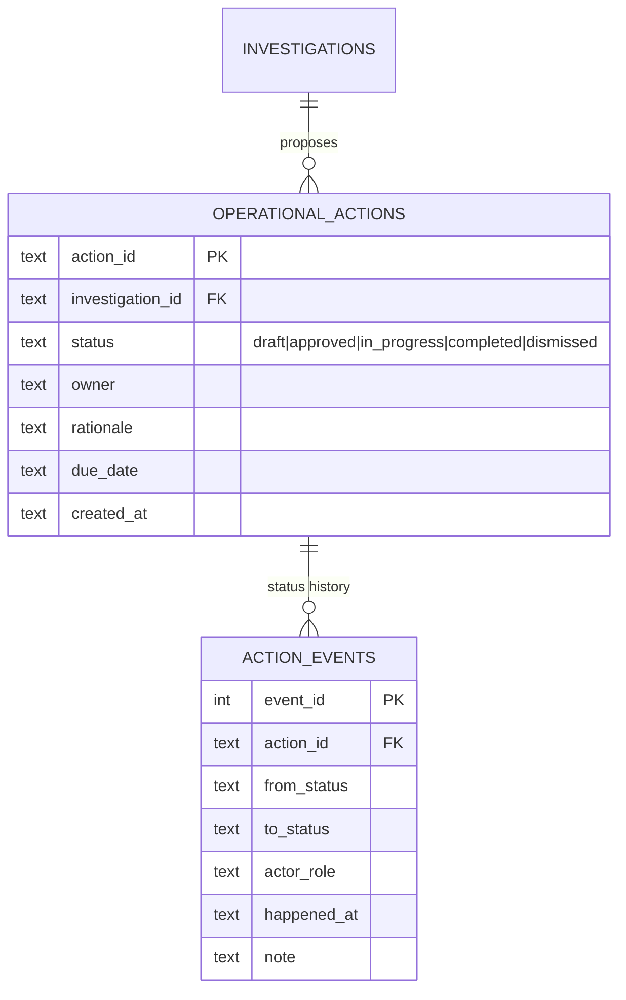
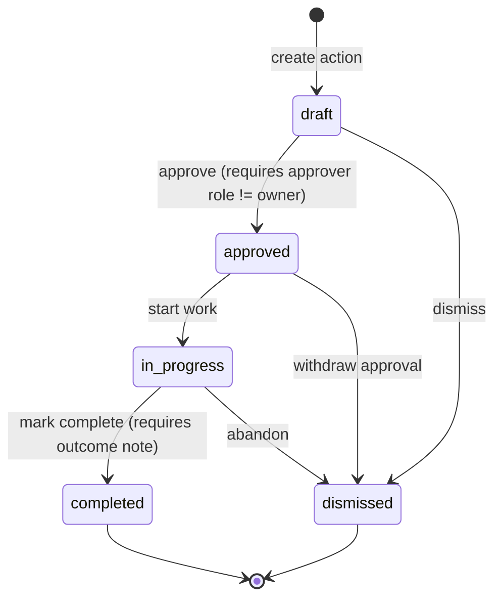

# OKai data model: actual schema and proposed target

This record separates what the application's SQLite databases actually contain
today from a proposed, additive extension. It does not propose replacing or
renaming any existing table. See [architecture](ARCHITECTURE.md) for the layer
responsibilities and [validation](VALIDATION.md) for verified evidence.

## Two physical databases

OKai keeps two separate SQLite files so a third-party import can never
overwrite or merge into the demo cohort:

- **`data/processed/signal.db`** — demo incident facts, ETL run history,
  predictions, demo review overlay, and the investigation/review tables below.
- **`data/processed/okai_imports.db`** — one or more immutable import cohorts:
  preserved source events, deterministic latest-event incident snapshots, and
  rejected rows.

## Actual entity relationship diagram (as implemented)

```mermaid
erDiagram
    %% --- data/processed/signal.db ---
    INCIDENTS ||--o| PREDICTIONS : "scored by"
    PIPELINE_RUNS ||--o{ REJECTED_RECORDS : "produced"
    DEMO_WORKSPACES ||--o{ DEMO_REVIEWS : "overlays"
    INCIDENTS ||--o{ DEMO_REVIEWS : "reviewed as"
    DEMO_REVIEWS ||--o{ DEMO_EVENTS : "audited by"
    CALCULATION_TRACES ||--o{ INVESTIGATIONS : "evidences"
    INVESTIGATIONS ||--o{ INVESTIGATION_EVENTS : "append-only history"

    %% --- data/processed/okai_imports.db (separate file) ---
    SOURCE_IMPORTS ||--o{ SOURCE_IMPORT_ATTEMPTS : "lifecycle of"
    SOURCE_IMPORTS ||--o{ SOURCE_EVENTS : "preserves"
    SOURCE_IMPORTS ||--o{ SOURCE_REJECTIONS : "records"
    SOURCE_EVENTS ||--o{ SOURCE_INCIDENTS : "pointed to by (latest whole event)"

    INCIDENTS {
        text incident_id PK
        text created_at
        text priority
        text category
        text status
        real response_time_minutes
        real resolution_time_minutes
        int sla_breached
    }
    PREDICTIONS {
        text incident_id PK_FK
        real breach_probability
        text risk_level
    }
    PIPELINE_RUNS {
        int run_id PK
        text source_file
        text status
    }
    REJECTED_RECORDS {
        int id PK
        int run_id FK
        text reason
    }
    DEMO_WORKSPACES {
        text workspace_id PK
    }
    DEMO_REVIEWS {
        text workspace_id PK_FK
        text incident_id PK_FK
        text review_state
        text owner
    }
    DEMO_EVENTS {
        int event_id PK
        text workspace_id FK
        text incident_id FK
        text note
    }
    CALCULATION_TRACES {
        text trace_id PK
        text source_id
        text incident_id
        text metric_id
        text payload_sha256
        text trace_json "immutable: triggers block UPDATE/DELETE"
    }
    INVESTIGATIONS {
        text investigation_id PK
        text source_id
        text incident_id
        text trace_id FK
        text owner
        text rationale
        text next_action "free-text minimal action attachment"
        text status "Open | Outcome recorded"
        text outcome_status
        real measured_value
    }
    INVESTIGATION_EVENTS {
        int event_id PK
        text investigation_id FK
        text event_type "created | outcome_recorded"
        text details_json "append-only: triggers block UPDATE/DELETE"
    }
    SOURCE_IMPORTS {
        text import_id PK
        text source_sha256
        text profile_fingerprint
    }
    SOURCE_IMPORT_ATTEMPTS {
        text attempt_id PK
        text import_id FK
        text status "preserving..committed|failed|interrupted"
    }
    SOURCE_EVENTS {
        text import_id PK_FK
        int source_row PK
        text incident_id
        text event_at
        text raw_record_json
    }
    SOURCE_INCIDENTS {
        text import_id PK_FK
        text incident_id PK
        int source_row FK "points at one whole SOURCE_EVENTS row"
    }
    SOURCE_REJECTIONS {
        text import_id PK_FK
        int source_row PK
        text reason
    }
```

Note: `DEMO_REVIEWS`/`DEMO_EVENTS` reference `INCIDENTS` only; an imported
source has no equivalent row-level demo overlay by design (read-only snapshot).
`INVESTIGATIONS.source_id` is a durable namespace (`synthetic-demo` or an
import ID), not a foreign key into either incident table, because one
investigation must outlive a workspace reset and remain valid across sources.

## Mapping to the requested logical entities

| Requested logical entity | Actual implementation | Gap |
|---|---|---|
| Import batch | `source_imports` (+ `source_import_attempts` for lifecycle) | None — already a first-class, hashed, versioned cohort |
| Incident event | `source_events` | None — full historical event log, append-only by construction |
| Incident snapshot | `source_incidents` (imported) / `incidents` (demo) | None — deterministic latest-whole-event pointer |
| Investigation | `investigations` + `calculation_traces` | None — this **is** the persistent, evidence-linked review |
| Review | Same `investigations` row | OKai uses one entity for "investigation" and "review"; see below |
| Review revision | `investigation_events` (append-only) | None for audit history; decision fields are immutable, not versioned/editable |
| Evidence reference | `calculation_traces.trace_json` (content-addressed, schema-versioned) | None |
| Operational action | `investigations.next_action` (free text) | **Partial** — no structured lifecycle (see below) |
| Action event | `investigation_events` (`created`, `outcome_recorded`) | **Partial** — two event types only, tied to the whole case, not a separate action entity |
| Outcome | `investigations.outcome_status/outcome_note/outcome_date/measured_value/measured_unit` | None |

**"Investigation" already is the "review."** The acceptance criteria describe
importing data, opening an investigation, saving it as a review, and reopening
it later; `src/investigations.py` implements exactly that lifecycle with one
table pair, not two. Introducing separate `investigations` and `reviews`
tables now would duplicate state without a behavioral difference. The
remaining gap is the **operational action lifecycle** described in
architecture section 06: a draft/approved/in-progress/completed/dismissed
status history with ownership, rationale, and due dates distinct from the
investigation's free-text `next_action`.

## Proposed target: structured operational actions

This is an additive, backward-compatible extension proposal, not implemented
in this milestone (per the instruction to implement the minimal review
relationship first). It would add two tables without touching any existing
one:



Design notes for a future milestone:

- `operational_actions.investigation_id` reuses the existing immutable
  evidence link; an action never needs its own calculation trace.
- `action_events` follows the same append-only pattern as
  `investigation_events` (triggers blocking `UPDATE`/`DELETE`), keeping one
  audit convention across the schema.
- Status transitions should be validated application-side (e.g. `dismissed`
  and `completed` are terminal) before being recorded, mirroring how
  `record_outcome` validates `OUTCOME_STATUSES` today.
- No automatic execution of an approved action is in scope; this remains a
  human-reviewed decision record, consistent with architecture section 06.

### Keys and columns (proposed)

| Table | Column | Type / rule |
|---|---|---|
| `operational_actions` | `action_id` | PK, generated (same `uuid4().hex` convention as `investigation_id`/`trace_id`) |
| | `investigation_id` | FK → `investigations.investigation_id`, `NOT NULL` |
| | `status` | `NOT NULL`, `CHECK` against the five-value enum below |
| | `owner` | `NOT NULL`, free text (role/person), same `_required_text` validation as `investigations.owner` |
| | `rationale` | `NOT NULL`, free text |
| | `due_date` | nullable `TEXT` (ISO date); absence means "no committed date," never a silent today/never default |
| | `created_at` / `updated_at` | `NOT NULL` UTC ISO-8601, same `_now()` helper already used everywhere in `investigations.py` |
| `action_events` | `event_id` | PK, `INTEGER AUTOINCREMENT` (matches `investigation_events` convention) |
| | `action_id` | FK → `operational_actions.action_id`, `NOT NULL` |
| | `from_status` | nullable (NULL only for the initial `created` event) |
| | `to_status` | `NOT NULL`, one of the five enum values |
| | `actor_role` | `NOT NULL` (the same `Analyst`/`Manager`/etc. role strings already used by `record_outcome`) |
| | `happened_at` | `NOT NULL` UTC ISO-8601 |
| | `note` | nullable free text (e.g. approval justification, dismissal reason) |

### Lifecycle state machine



| From | To | Allowed? | Validation rule |
|---|---|---|---|
| `draft` | `approved` | Yes | Requires a non-empty `note` recording who approved and why; `actor_role` must differ from the action's `owner` role (no self-approval) |
| `draft` | `dismissed` | Yes | Requires a non-empty `note` (dismissal reason) |
| `approved` | `in_progress` | Yes | No extra fields required beyond the status change itself |
| `approved` | `dismissed` | Yes | Requires a non-empty `note` (withdrawal reason) |
| `in_progress` | `completed` | Yes | Requires a non-empty `note` describing the completed work; this is where a future "measured outcome" link would attach |
| `in_progress` | `dismissed` | Yes | Requires a non-empty `note` |
| `completed`, `dismissed` | any | **No** | Terminal states; application code rejects the transition (mirrors `investigations` decision-field immutability, enforced by a trigger at the database layer, not only in Python) |
| any state | same state | **No** | No-op transitions are rejected, not silently accepted, so `action_events` never records a vacuous entry |

### Ownership, due dates, and approval

- **Ownership** is a required field at creation (`operational_actions.owner`),
  consistent with `investigations.owner`; it identifies who is responsible for
  the action, not who created the record.
- **Approval** is modeled as a status transition (`draft` → `approved`), not a
  separate boolean flag, so the identity and rationale of the approver are
  preserved in `action_events` exactly once, append-only, instead of being
  overwritable metadata. The no-self-approval rule (`actor_role` performing
  the transition must differ from `owner`) is the minimum separation-of-duties
  control; a future milestone could tighten this to a real identity/role
  system once one exists (today's personas are simulated, per
  `docs/ARCHITECTURE.md`).
- **Due dates** are optional and advisory only in this proposal: nothing in
  the design automatically escalates, notifies, or blocks on an overdue
  action. Introducing automatic enforcement is explicitly out of scope
  (architecture section 06: "do not automatically execute operational
  decisions").

### Auditability

- `action_events` is append-only via the same `BEFORE UPDATE`/`BEFORE DELETE
  ... RAISE(ABORT, ...)` trigger pattern as `investigation_events`, so the
  full status history — including who approved what and when — cannot be
  edited or deleted after the fact.
- `operational_actions.status` itself is mutable (unlike `investigations`'
  frozen decision fields) because a lifecycle *must* progress, but every
  transition is only ever applied through one validated function (proposed
  `transition_action(action_id, to_status, actor_role, note, db_path)`) that
  writes the new status and the matching `action_events` row inside a single
  transaction — never two independent writes that could diverge.

### Recommended smallest implementation slice

1. Add the two tables above (`operational_actions`, `action_events`) to the
   same schema script in `src/investigations.py`, with the same immutability
   trigger pattern already in use — no change to `investigations` or
   `calculation_traces`.
2. Add one creation function (`propose_action`) and one transition function
   (`transition_action`) enforcing the table above; reuse `_required_text`,
   `_now()`, and the existing connection-context-manager pattern.
3. Add one read function (`read_actions(investigation_id)`) and surface it as
   a small, read-mostly panel inside the existing Investigations workbench —
   not a new page, consistent with "do not build a parallel review system."
4. Defer "measured outcomes" linkage (connecting a `completed` action back to
   a quantified result) to the milestone after this one; the `note` field on
   the `completed` transition is sufficient for the first slice, per the
   instruction to implement "the minimum necessary action attachment" before
   a comprehensive action management system.
